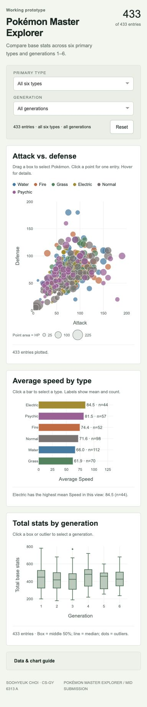
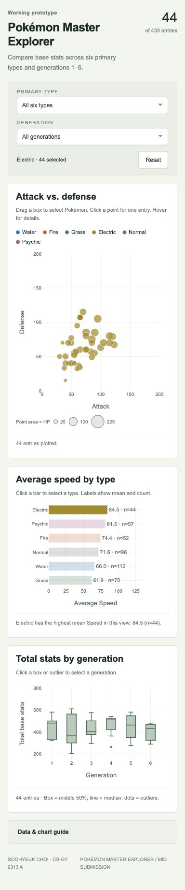

# Pokémon Master Explorer

Working prototype · Soohyeuk Choi · Information Visualization · CS-GY 6313 A

A local Plotly Dash dashboard with three linked views of Pokémon base stats.

## Mid-progress submission

This repository contains the working local prototype and setup instructions, two current screenshots, and the [in-class feedback log](FEEDBACK-LOG.md). The session was missed, so the log records that no peer feedback was collected.

### Screenshot 1: full dataset

All 433 entries appear in three coordinated views. Point color encodes type and point area encodes HP.



### Screenshot 2: linked selection

Clicking the Electric bar selects 44 entries in the scatterplot and generation boxes. The speed chart retains all six types for comparison and fades the unselected bars. Reset restores the full dataset.



## Run

Use Python 3.10 or later. Download this repository using **Code → Download ZIP** and extract it (or clone it), then open a terminal in the project folder:

```sh
python3 -m venv .venv
source .venv/bin/activate
python -m pip install -r requirements.txt
python app.py
```

On Windows, activate with `.venv\Scripts\activate` instead.

Open [http://127.0.0.1:8050](http://127.0.0.1:8050). Stop the server with Ctrl+C.
Internet is needed to install dependencies; the app loads its dataset locally.

For later runs, activate the environment and run `python app.py` again.

## Charts and interactions

- **Attack vs. defense:** position shows Attack and Defense, color shows primary type, and point area shows HP. Drag a box or click a point to select entries.
- **Average speed by type:** horizontal bar length shows mean Speed from zero. Labels show the mean and entry count. Click a bar to select its type.
- **Total stats by generation:** box plots show the distribution of Total in generation order. Click a box or outlier to select a generation.

The type and generation dropdowns filter all three charts. A chart selection keeps context in that chart and filters the other two. Each new selection replaces the previous one. Dropdown changes clear chart selections; **Reset** restores all 433 entries. Hover for detailed values.

## Project structure

```text
pokemon-master-explorer/
├── app.py             # Server startup and interaction callbacks
├── data.py            # CSV loading, numeric conversion, and validation
├── charts.py          # One builder per chart and shared Plotly styles
├── layout.py          # Title, controls, chart panels, and data guide
├── assets/
│   └── style.css      # Page styling; loaded automatically by Dash
├── data/
│   └── Pokemon.csv    # Complete local dataset
├── requirements.txt   # Runtime dependencies
├── pyproject.toml     # Python formatter settings
└── VALIDATION.md      # Verification notes
```

Start reading at `app.py`. Its callbacks apply filters and selections, then call the builders in `charts.py`. Change page content in `layout.py` and appearance in `assets/style.css`.

`data.py` is the Python module; `data/` is the folder containing the CSV. This project has one Dash implementation and no separate static preview or frontend build step.

## Data

Source: Alberto Barradas, [Pokémon with stats](https://www.kaggle.com/datasets/abcsds/pokemon).
The CSV was retrieved November 12, 2026 from this [dataset mirror](https://raw.githubusercontent.com/prasertcbs/basic-dataset/master/Pokemon.csv).

The file contains 800 entries and 721 distinct Pokédex numbers. The dashboard focuses on six primary types: Water (112), Fire (52), Grass (70), Electric (44), Normal (98), and Psychic (57), for 433 entries across generations 1–6. Alternate forms count separately.

Numeric fields are converted on load. The app checks source and scope counts and verifies that Total equals HP + Attack + Defense + Sp. Atk + Sp. Def + Speed. Blank secondary types are retained; no missing-value imputation is applied. These comparisons do not cover every type or later generations, and base stats alone do not predict battle outcomes.

## Design

The proposal's Layout A places a large scatterplot beside two grouped summary charts. Shared type colors, proximity, and panel borders connect the views. Panels stack on smaller screens.

Attack, Defense, Generation, and Total use position; primary type uses categorical color; HP uses point area with a size key; mean Speed uses bar length from zero. Box plots show the middle 50%, median, whiskers within 1.5 IQR, and outlier dots.


## Status and acknowledgements

This is the working prototype, not the final submission. No peer feedback or usability testing is claimed; final reports and accessibility tuning remain unfinished.

Charts use [Plotly Dash](https://dash.plotly.com/) and [Plotly](https://plotly.com/python/), installed through `requirements.txt`. OpenAI Codex GPT-6 Astra Medium helped with MD file writing, CSS styling, and basic Flask syntax. 
